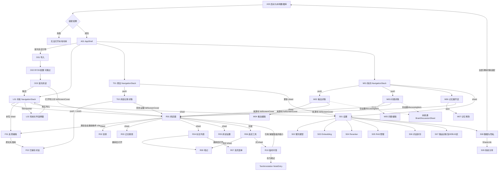
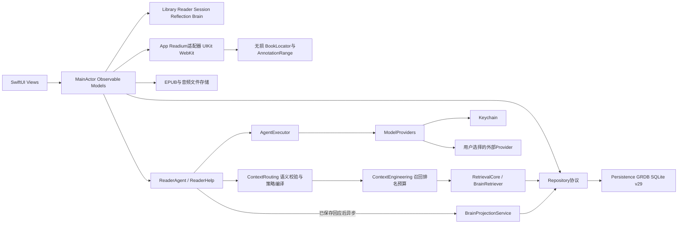
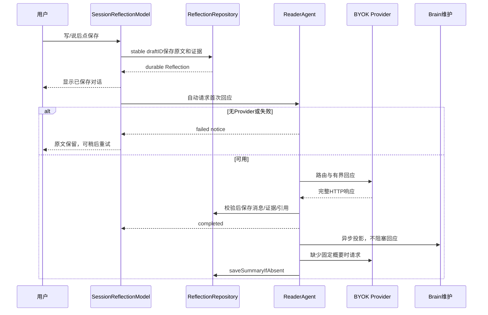

# 导航架构与真实用户路径

基线、状态定义与运行边界见 [研究入口](README.md)。节点编号对应 [页面清单](00-screen-inventory.md)。实线表示可达代码路径，虚线只表示已发现但未接通的路径；图不代表所有节点本次均已运行。

## 1. 实际导航拓扑



导航依据：[Tab / 阅读器全屏 / 引导](/Users/zpc/projects/elsepage/App/AppShell.swift:16)；[书架各presentation](/Users/zpc/projects/elsepage/App/Library/LibraryView.swift:79)；[ReaderSheet / note / help / reflection](/Users/zpc/projects/elsepage/App/Reader/ReaderScreen.swift:68)；[记录详情](/Users/zpc/projects/elsepage/App/Thoughts/ThoughtsView.swift:58)；[我的各presentation](/Users/zpc/projects/elsepage/App/MyMind/MyMindView.swift:69)；[设置子页](/Users/zpc/projects/elsepage/App/Settings/SettingsView.swift:18)。

阅读器多种容器的区别必须保留：书架 push 可以 zoom 回封面；档案/Brain 回原文是根 Shell 的全屏 cover，关闭后回到原详情。它们都复用 ReaderScreen，但不能随意统一成一个新栈，否则 dismiss、Tab 隐藏、会话结束、引用返回和成就注入会一起改变。

## 2. 应用与服务关系



图中的箭头是跨层协作关系，非全部直接Swift import；精确依赖表见 [Package targets](/Users/zpc/projects/elsepage/Package.swift) 与 [产品架构 §4](00-product-understanding.md)。Readium 只在App适配器接触，ReaderCore / RetrievalCore 不 import Readium。Brain 维护与正文问答使用不同的持久化权限。

## 3. 首次启动与首次导入

**实际路径**：A00 → AppModel.start → 本地迁移/装配 → 首次引导 O01 → L02 选 EPUB → LibraryModel.importBook → O01成功 → O02配置或跳过 → O03打开书/回书架。

导入执行 security-scoped access → NSFileCoordinator临时复制 → ReadiumMetadataReader → BookImporter容器检查、fingerprint去重、文件promote与DB insert → reload → BookIndexCoordinator.enqueue。重复不是第二本书；错误保留引导且可跳过。成功写入书架与引导使用同一对象图。

**本次**：上述路径到书架、首次打开阅读器均真实完成。测试书为仓库CC0单章英文最小EPUB。为让系统选择器找到文件，只把fixture复制进该模拟器的本地File Provider；没有注入数据库、修改App、预设引导完成标记或伪造导入结果。无Key跳过AI，未做连接成功验收。

外部打开：ReadLoopApp.onOpenURL → AppModel.pendingImportURL → library ready后import → openLibraryAfterExternalImport切书架。这里只缓冲一个URL，不是多文件队列；本次未测冷启动外部文件打开。

证据：[handleIncoming / 后续引导判断](/Users/zpc/projects/elsepage/App/AppModel.swift:246)；[importBook](/Users/zpc/projects/elsepage/App/Library/LibraryModel.swift:105)；[文件与DB导入](/Users/zpc/projects/elsepage/Sources/AppInfrastructure/BookImporter.swift:14)。

## 4. 浏览书架、打开书籍、阅读与章节导航

1. L01书名/作者内存搜索与排序，封面独立加载；点封面新建ReaderModel。
2. ReaderModel.prepare并行读取位置/偏好，启动Readium preload；放行后构建navigator，标注等后置加载。
3. Coordinator.open解析publication、建立目录/搜索handler，恢复Locator，应用偏好、highlights、notes。
4. 首次locationDidChange更新进度并隐藏控制栏；轻点正文切换控制栏。
5. R02选章、R03搜索结果、R04标注跳转经过ReaderModel.jump；记录跳前位置，出现“返回跳转前位置”入口。
6. 控制栏返回/“读到这里”结束会话。若无有效结束结果，当前finishReading也会dismiss；不可只加一个新的返回手势而忽略此副作用。

**本次**：已见到真实正文、0%进度、隐藏/显示控制栏、单章目录与阅读设置。最小样书只有一屏，不能证明多章翻页、长文滚动、复杂目录和跨资源导航。没有完成强杀恢复，也不宣称进度已验证持久。

证据：[prepare / save](/Users/zpc/projects/elsepage/App/Reader/ReaderModel.swift:155)；[open](/Users/zpc/projects/elsepage/App/Reader/ReadiumReaderView.swift:46)；[jump / navigateBack](/Users/zpc/projects/elsepage/App/Reader/ReaderModel.swift:786)；[finishReading](/Users/zpc/projects/elsepage/App/Reader/ReaderScreen.swift:244)。

## 5. 文本选中、高亮与笔记

```mermaid
stateDiagram-v2
    [*] --> Reading
    Reading --> Selection: 长按并转换Locator/Range
    Selection --> Reading: 点色 创建或更新Highlight
    Selection --> Note: 笔记 创建空NoteEntry
    Selection --> Help: 问
    Selection --> Reading: 复制或点外部
    Reading --> HighlightMenu: 点已有高亮
    Reading --> Note: 点独立下划线
    Reading --> Conflict: 点重叠区域
    Conflict --> HighlightMenu: 选高亮
    Conflict --> Note: 选笔记
    HighlightMenu --> Reading: 换色或点外部
    HighlightMenu --> UndoNotice: 删除HighlightLayer
    Note --> Note: 预览/编辑/追加/切换条目
    Note --> Reading: 非空内容保存并关闭
    Note --> UndoNotice: 清空已存在笔记后关闭
    UndoNotice --> Reading: 撤销或5秒到期
    Help --> Reading: 关闭丢弃
```

选区菜单与已有高亮/冲突菜单由一个enum互斥管理。坐标在navigator全屏空间，overlay忽略safe area后自行clamp；旋转、后台和真实跳转需要清理旧锚点。Readium位置回调不一定表示用户翻页，当前实现不会在每次回调都清菜单。

高亮与Note不是父子：相同Range共用TextAnnotation，色层独立，NoteEntry可多条。相同范围改色不新建；部分交叉高亮拒绝；删除色层保留Note。Note默认预览，只有编辑态调出键盘，400ms延迟保存，所有关闭路径finalize；清空会删当前NoteEntry并给撤销。

**本次**：长按“begins” → 自定义4色菜单 → 黄色高亮已呈现；选择“reader” → 笔记空预览 → 编辑态。DB只读核查为1个高亮、1个空NoteEntry；UI控制通道失效使笔记文字提交未完成，不能标为保存通过。

证据：[overlay与菜单](/Users/zpc/projects/elsepage/App/Reader/AnnotationUI.swift:47)；[saveHighlight](/Users/zpc/projects/elsepage/App/Reader/ReaderModel.swift:308)；[独立层删除](/Users/zpc/projects/elsepage/App/Reader/ReaderModel.swift:642)；[NoteEditorSheet](/Users/zpc/projects/elsepage/App/Reader/AnnotationUI.swift:434)；[事务持久化与legacy镜像](/Users/zpc/projects/elsepage/Sources/Persistence/TextAnnotationRepository.swift:29)。

## 6. 阅读中的提问、AI回应与引用回跳

R06“问” → R10 idle，显示选中原文和“解释这段”；用户点解释或输入具体问题才发请求。ReaderHelpService不接入Reflection/Brain/session/trace仓库，复用检索/执行/引用校验，不做完整Reflection上下文规划。

成功回答后可追问、复制，点“存为笔记”把本thread可保存内容写成NoteEntry；同一latestResponseID防重复。保存后或点击引用时面板缩为184pt，保留thread并露出正文。X调用discard并取消请求、清空thread；下滑不能关闭。只在ReaderModel存活期间保留同锚点的临时状态，退出阅读器后不恢复。

**本次**：idle与未配置Provider错误、重试按钮已观察；X关闭已返回正文。无真实Key，因此成功回答、保存回答为笔记、引用精确跳转、取消网络请求耗时均未验收。

证据：[askAgentFromSelection](/Users/zpc/projects/elsepage/App/Reader/ReaderModel.swift:422)；[无持久化仓库的临时服务](/Users/zpc/projects/elsepage/Sources/ReaderAgent/ReaderHelpService.swift:12)；[handleCitation](/Users/zpc/projects/elsepage/App/Reader/ReaderHelpSheet.swift:356)；[saveLatestAnswer](/Users/zpc/projects/elsepage/App/Reader/ReaderHelpModel.swift:177)。

## 7. 读后反思、对话与历史内容管理

邀请条件为：已结束会话，且满足壁钟≥3分钟、进度增加≥0.005、高亮数>0、笔记数>0任一。不是“每次开书退出都会弹”，也不是主动阅读时长精确统计。符合条件后F01可写/说/跳过；稍后在当前书卡可补写。



保存后自动回应与“本地优先”并存：本地保存不以Provider成功为前置。后续发送则先生成pending气泡、清当前草稿，再保存用户message；稳定UUID用于重试；成功落库后再处理音频提升。删除只允许最后一条用户轮及其后AI回应，逐轮删到根时才删整条Reflection/对话；不能改成任意消息编辑器而保留原先删除文案。

想法Tab加载本地档案和Journal，并调度缺回应/概要的后台补齐；不是监听网络恢复立刻续跑。按月/按书分组只是两种投影。记录详情复用F02，顶部概要有本地fallback，“这次留下”仅数据存在时展示。原始Expression与AI整理的看法、Brain Thought是三类不同实体。

**不一致项**：当前无可达Journal编辑器；“继续想想”的Brain Sheet未接通；选区Reflection旧方法也没有当前工具栏入口。旧文档要求的这些动作不能作为本次已走通路径。

**本次**：正式F01/F02/T01/T02未实际走到。DEBUG `save`只是在独立内存GRDB装配真实SessionReflectionModel调用submit，验证保存/幂等/空白拒绝；不冒充真实UI保存或磁盘强杀恢复。

证据：[MeaningfulReadingSessionPolicy](/Users/zpc/projects/elsepage/Sources/ReadingSessionCore/ReadingSessionService.swift:90)；[补写状态](/Users/zpc/projects/elsepage/App/Library/LibraryNextActionModel.swift:28)；[先存原文](/Users/zpc/projects/elsepage/App/Reflection/SessionReflectionSheet.swift:593)；[追问交付](/Users/zpc/projects/elsepage/App/Reflection/SessionReflectionSheet.swift:834)；[最新轮删除](/Users/zpc/projects/elsepage/Sources/Persistence/ReflectionRepositories.swift:267)；[缺回应补齐](/Users/zpc/projects/elsepage/App/Thoughts/ThoughtsModel.swift:95)。

## 8. Brain、设置、错误与数据恢复

Brain：M01 → 看法/问题详情 → 证据中的原始Reflection片段 → 有书及Locator时 fullScreenCover 到原文。反向引用旧Reflection目前没有通用跳记录路径。看法stable可生成derivedMemory关系；问题可链接非archived看法为回答。记忆修改先尝试记录旧陈述，改为userExplicit/active；不准确改superseded；“忘记”硬删；全部清除只清memory。

设置：三个Tab都进入同一SettingsRootModel的Sheet；子页在Sheet内部push。保存配置与测试连接是不同动作；身份名/头像即时写AppStorage。Embedding/Reranker角色拥有独立配置与密钥，也兼容既有共用配置；不等同于“每个角色自动独立账户”。

恢复分四种，不能合成一个“恢复数据”入口：

- 阅读位置/偏好：已有持久化时下次prepare恢复，导航历史只在内存。
- 文件事务：导入失败清理staging，删文件先入trash，DB失败则尝试恢复；音频promotion在启动recover。不是用户可浏览的回收站。
- Agent派生：通过已存原文/消息重试和想法页补齐，无进程级AgentRun恢复。
- 用户备份：JSON可导出分享，当前无导入还原、iCloud同步或跨机恢复UI。

全清是S08展开范围清单 → 最终Alert → 取消索引 → 文件暂存 → wipe DB/Keychain →清文件/偏好 → AppModel重建并再引导。数据库、Keychain与文件不是单一事务，错误后可能只完成一部分。启动DB错误没有内建修复界面。

**本次**：这些页面/恢复动作未运行，保留当前最小样书和空笔记，没有清除用户任何既有数据。后续审计需代表性Brain样本、可用Provider和真实设备。

证据：[记忆操作](/Users/zpc/projects/elsepage/App/MyMind/MyMindModel.swift:119)；[BrainEvidenceSection](/Users/zpc/projects/elsepage/App/MyMind/MyMindView.swift:990)；[设置加载/跨角色协调](/Users/zpc/projects/elsepage/App/Settings/SettingsRootModel.swift:32)；[全清](/Users/zpc/projects/elsepage/App/Settings/DataSettingsModel.swift:176)；[重装配](/Users/zpc/projects/elsepage/App/AppModel.swift:259)。
