# 阅读体验重构报告

2026-11-15。对象：ElsePage 阅读器（Readium EPUB + 原位标注 + 选句问答）。本轮只改阅读体验及其直接依赖的展示层；没有改 RAG 检索、Agent 策略、防剧透规则或标注/会话持久化。

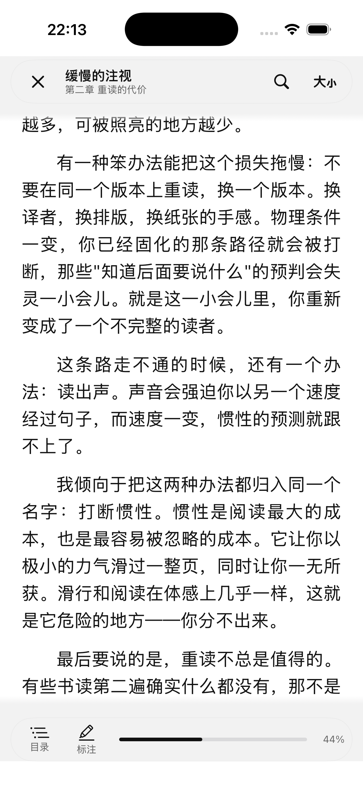

## 1. 重构前基线

### 1.1 现有能力

| 能力 | 实现位置 | 基线行为 |
| --- | --- | --- |
| EPUB 渲染与翻页 | `ReadiumReaderView` + `EPUBNavigatorViewController` | Readium 负责分页/滚动、资源间翻页、文本选择 |
| 阅读位置 | `ReaderModel.save(locator:)` / `flushPosition()` | `locationDidChange` 后 750ms 防抖写入；后台、退出、旋转前 flush |
| 章节 | `ReadiumBookIndexer` / `ReaderModel.chapters` | 从 `tableOfContents` 展平，保留层级与 locator |
| 选区 | `shouldShowMenuForSelection` | 抑制系统菜单，改用 App 原位工具栏；保留 Copy 供硬件键盘 |
| 高亮/批注 | `TextAnnotation` + Readium decorations | 高亮、下划线、同段多笔记、重叠冲突菜单、删除撤销 |
| 问 AI | `ReaderHelpModel` / `ReaderHelpSheet` | 流式回答、引用校验、来源列表、存为笔记 |
| 引用回跳 | `ReaderScreen.jumpToCitation` | 用 evidence locator 跳转，并显示“已回到原文” |
| 会话/反思 | `ReaderModel.endReadingSession` | 退出阅读可结束会话并进入补写想法 |

### 1.2 必须保持不变的契约

- locator 的写入时机、去抖与 flush 路径；
- EPUB 渲染、分页/滚动模式、章节跳转；
- 选区 → 高亮/笔记/问 AI 的数据路径；
- 同一文本范围的多条笔记、重叠高亮的冲突菜单；
- 引用的 locator 解析与防剧透上下文边界；
- 取消、失败、重试与后台恢复。

### 1.3 基线截图

| 状态 | 截图 |
| --- | --- |
| 沉浸阅读 | 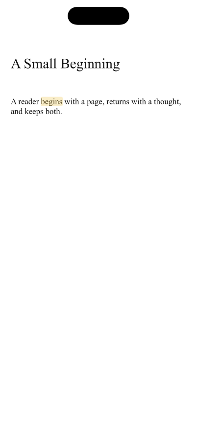 |
| 控制栏 | 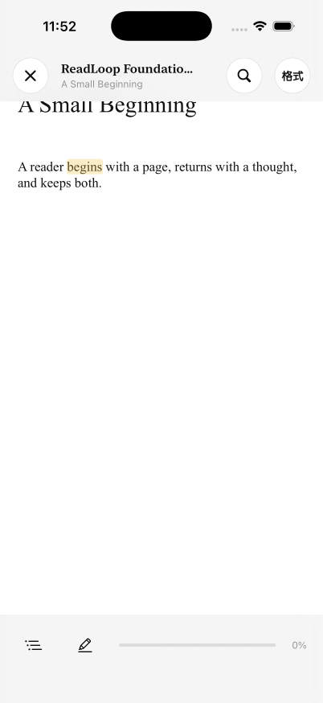 |
| 选区工具 |  |
| 问 AI | 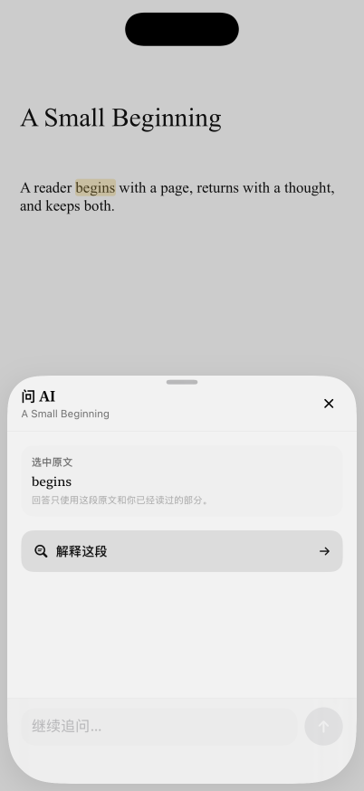 |

基线的两个直接问题：

1. 控制栏出现时，顶部 chrome 覆盖章节标题第一行（UX-011）。
2. 选区工具是两行、约 104pt 高，遮住刚选中的段落；主操作“问”只有一个字。

## 2. 主要修改文件

| 文件 | 修改 |
| --- | --- |
| `App/Reader/ReaderScreen.swift` | 顶部/底部两枚完整浮动胶囊（页面底色 + 细描边 + 少量渐隐）；正文不再预留 chrome 边距；目录定位；设置页恢复默认 |
| `App/Reader/ReadiumReaderView.swift` | `navigatorContentInset` 只保留安全区，正文使用完整页面；不再在配置里写固定 8/16 |
| `App/Reader/AnnotationUI.swift` | 单行选区工具栏；高亮菜单增加“笔记”；暗色对比；笔记编辑器直接进入写作 |
| `App/Reader/ReaderHelpSheet.swift` | 300pt 初始高度；隐藏拖拽指示；停止按钮；自动滚到底部；统一错误卡；引用箭头；AX 自动展开 |
| `Sources/ReaderCore/BookLocator.swift` | 长文默认排版从 1.05/1.2/1.1 调整为 1.2/1.6/1.2 |
| `Tests/ReadLoopCoreTests/ReaderCoordinationTests.swift` | 更新默认排版断言 |
| `Tests/DesignSystemTests/DesignSystemTokenTests.swift` | 新增 chrome 不预留正文边距、且行高满足触控目标的约束测试 |
| `docs/design/assets/reader-redesign/*` | 重构前后模拟器截图 |

## 3. 体验改动

### 3.1 正文排版

- 默认字号 1.05 → 1.2，行高 1.2 → 1.6，页边距 1.1 → 1.2；目标是接近设计文档的约 20pt 正文与更松的行距。
- 阅读设置里新增“恢复默认”，让已有书也能回到新排版；每本书已保存的偏好不被静默改写。
- 段落间距仍为 0.65；没有改 publisher CSS、字体族或 Readium 渲染流程。

### 3.2 工具栏的显示与隐藏

- 控制栏改为两枚完整的浮动胶囊：顶部一枚容纳退出/返回、书名/章节、搜索/阅读设置；底部一枚容纳目录/标注/进度。
- **正文不再为 chrome 预留任何边距**。`navigatorContentInset` 只保留安全区，正文使用完整页面；胶囊显示时直接覆盖在文字上，隐藏后页面一像素不少。
- 胶囊使用页面底色填充（随主题变化）和细描边，保证文字透不过来；胶囊上下各有一小段页色渐隐，遮住被胶囊边缘切断的半行字，而不是把它硬切。
- 顶栏和底栏各 48pt；正文永久边距从 48/56 改为 0/0。控制栏显示/隐藏只做透明度过渡，不重排；代价是 chrome 出现时会盖住顶部/底部少量文字，这是有意的取舍。
- 书名 15/600 + 章节 11；书名保持一行并允许 0.8 缩放。底栏“目录 / 标注”保留图标 + 11pt 标签，进度线保留。
- chrome 文本上限 `xxxLarge`；阅读正文仍按阅读字号渲染，不跟随 Dynamic Type。

| 控制栏（正文页中段） | 暗色 |
| --- | --- |
|  | 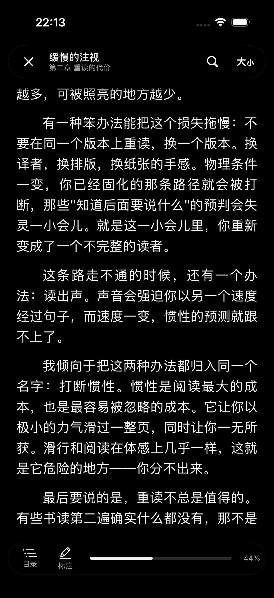 |

胶囊覆盖正文时，顶部渐隐把被切断的行收掉；返回按钮出现时仍是一枚完整胶囊：

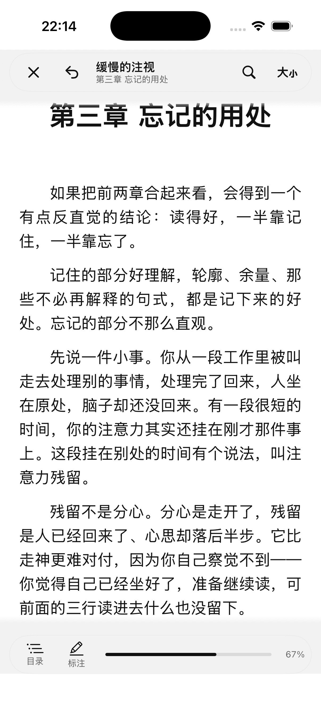

### 3.3 章节导航

- 目录打开时自动滚到当前章节并居中，当前章节保留强调色 + 勾选。
- 行高至少 44pt，标题允许两行，层级缩进沿用原数据。

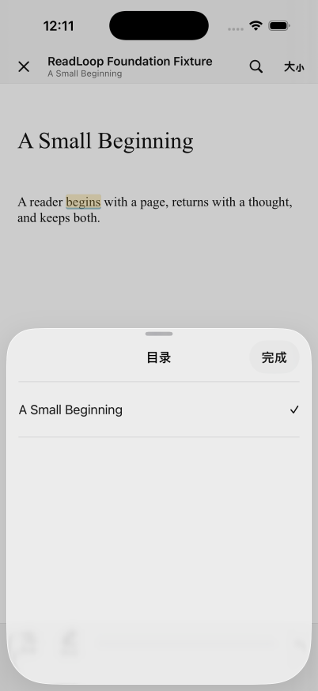

### 3.4 选区与高亮

- 选区工具从两行改为一行：四个色点 + 分隔线 + 笔记 / 问 AI / 复制。
- 高度约 52pt，视觉上不再压住整段选中文字；每个动作保留 44pt 命中区。
- 高亮菜单新增“笔记”，与调色、删除同排；不需要先进入冲突菜单才能补写。
- 暗色下显式使用语义前景色，避免材质上的低对比。

| 选区 | 高亮菜单 |
| --- | --- |
| 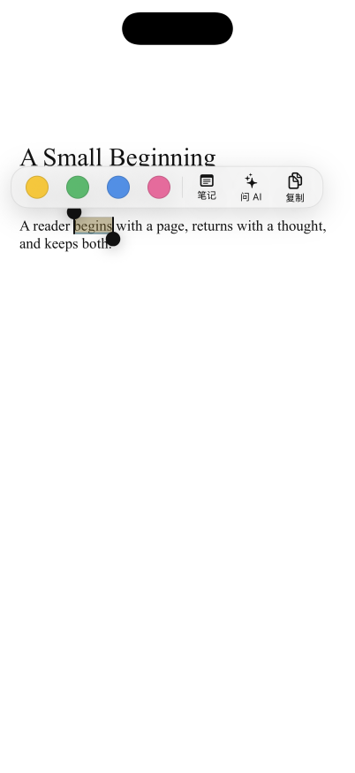 |  |

### 3.5 轻量批注

- 新笔记直接进入编辑态并聚焦，不再先展示空预览、再让用户点“编辑”。
- 已有内容仍先读预览，避免键盘遮住原文。
- 顶部从分段控件改为单一“编辑/预览”切换；“追加”“第 N 条”保留。
- 空编辑器有占位文案；清空已有笔记仍走“删除 + 撤销”。
- 从空笔记退出会删除空记录并提供撤销，不把空条目留在标注列表。

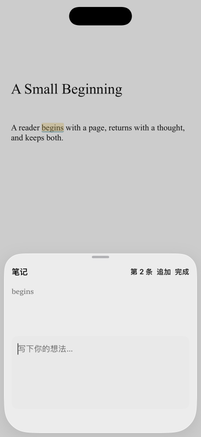

### 3.6 阅读 → AI 的转换

- 问答 Sheet 初始高度 300pt，先露出选中原文与“解释这段”，不会一上来盖住半屏以上。
- 原文卡保留“只使用这段原文和你已经读过的部分”，把防剧透边界放在提问前而不是失败后。
- 隐藏拖拽指示，因为 Sheet 仍不可下滑关闭；关闭有内容时确认“丢弃这次问答”。

### 3.7 AI 加载、流式与错误

- 新增 `ScrollViewReader` 底部锚点：新 turn、流式增量、状态变化都滚到最新内容。
- 生成中把发送按钮换成“停止回答”，对应 `ReaderHelpModel.cancel()`；停止后可重试。
- 失败统一为错误卡：说明 + 重试 +（未配置时）去设置聊天模型，去掉底部的重复“重试”。
- 流式增量仍走原有 50ms `StreamingResponseBuffer`，没有改网络或 Agent 逻辑。

| 问答空态 | 未配置 Provider |
| --- | --- |
| 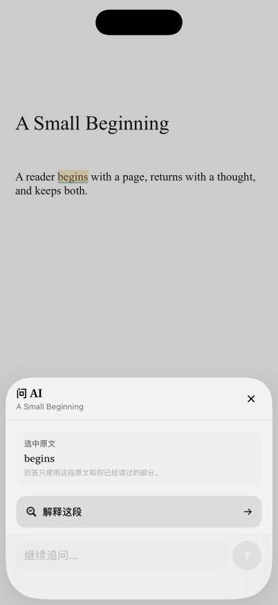 | 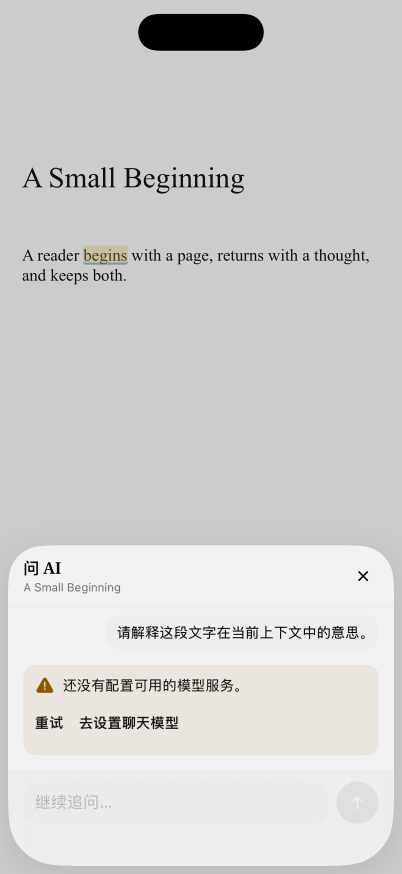 |

### 3.8 引用显示与回跳

- 可跳转来源右侧增加右上箭头，明确“会离开 Sheet”。
- 点击来源仍把 Sheet 收到 184pt，保留临时对话；同时把“已回到原文”提示抬到 Sheet 上方，不再被 Sheet 挡住。
- 没有 locator 的过去反思仍不伪装成可跳转按钮（沿用上一轮修复）。
- 跳转本身仍走 `ReaderModel.jump`，位置、返回历史与 chrome 隐藏不变。

### 3.9 返回阅读器的连续性

- 引用回跳时 Sheet 不销毁，对话与引用仍在；上滑即可继续追问。
- 退出阅读、后台、旋转仍走原 `flushPosition`；本轮没有改读写路径。
- 退出问答（X）仍需确认，避免误丢临时对话；阅读位置保持不变。

## 4. UX 问题与解决方案映射

| 问题 | 状态 | 本轮处理 |
| --- | --- | --- |
| UX-011 控制栏覆盖章节标题 | **按新方向调整** | 不再预留永久边距；chrome 是临时浮层，显示时可覆盖少量文字，隐藏后完整恢复。章节起始页因标题自身留白，标题仍完整 |
| 新：永久上下留白像“工具栏停车位” | **已修复** | 正文边距设为 0；顶部/底部各一枚完整浮动胶囊；中文长页正文填满页面 |
| UX-018 拖拽指示与不可下滑矛盾；X 无确认 | **已修复** | 隐藏指示；有内容时确认丢弃 |
| UX-013 引用点击无反馈 | **强化** | 来源加箭头；收起 Sheet 时“已回到原文”显示在 Sheet 上方；无 locator 来源仍只读 |
| UX-014 提问前没有边界说明 | **保持** | 原文卡保留“只使用这段原文和已读部分” |
| UX-007 未配置 Provider 是死路 | **push 路径修复** | 错误卡内“去设置聊天模型”；fullScreenCover 入口仍未传 `onOpenSettings` |
| UX-027 触达尺寸 | **新区域修复** | 选区工具每个动作 ≥44pt；底栏按钮 ≥48×44 |
| 新：两行选区工具遮挡 | **已修复** | 单行 52pt 工具栏 |
| 新：空笔记先预览多一步 | **已修复** | 新笔记直接编辑并聚焦 |
| 新：问答无停止 | **已修复** | 生成中显示停止按钮 |
| 新：流式回答不跟随 | **已修复** | 底部锚点自动滚动 |
| 新：错误重试重复 | **已修复** | 统一错误卡，移除 composer 顶部重试 |
| 新：目录不定位当前章 | **已修复** | `scrollTo(current, anchor: .center)` |
| 新：引用提示被 Sheet 挡住 | **已修复** | `noticeBottomInset` 抬升提示 |
| 新：默认排版偏紧 | **已修复（新书/恢复默认）** | 1.2 / 1.6 / 1.2；已有偏好保留 |

## 5. 验证记录

### 5.1 模拟器交互

设备：iPhone 17 Pro，iOS 26.5，`com.readloop.reader` Debug。所有截图在启动/打开书后等待内容出现再截取。

| 场景 | 结果 |
| --- | --- |
| 打开书 → 轻点正文 | 顶部/底部各出现一枚完整胶囊；正文不再被预留边距压缩；再点隐藏 |
| 显示/隐藏 chrome | 正文不重排、不跳动；控制栏前后正文坐标一致；隐藏后页面恢复完整 |
| 中文长页正文中段 | 正文填满页面；顶部胶囊直接覆盖文字，渐隐收掉被切断的半行；底部胶囊不压住可读内容 |
| 章节起始页 | 标题自身留白足够，胶囊不压标题 |
| 跳章后的返回按钮 | 顶部胶囊同时容纳 X + 返回 + 书名/章节 + 搜索/字号，仍为完整胶囊 |
| 暗色 | 页面底色胶囊、描边、书名、进度与正文对比正常 |
| 无障碍大字号 | 顶栏文字放大到 `xxxLarge` 上限仍不裁切；底栏两行布局可用 |
| 长按选词 | 单行工具栏出现；笔记/问 AI/复制均可点；44pt 命中 |
| 点“笔记” | 直接进入编辑态并聚焦；空笔记退出出现“已删除笔记 / 撤销” |
| 点高亮 | 高亮菜单出现：四色 + 笔记 + 删除 |
| 点“问 AI” | Sheet 先显示原文卡与“解释这段”，未遮住选中句 |
| 未配置 Provider 提问 | 错误卡显示说明、重试、去设置；无重复重试 |
| 关闭有内容的问答 | 出现“丢弃这次问答？”确认；可从“丢弃并关闭”退出 |
| 目录 | Sheet 打开，当前章节有勾选并居中 |
| 暗色（选区/高亮） | 正文、选区工具、高亮菜单对比正常 |
| 无障碍大字号（问答） | 选区工具自动隐藏文字标签；问答 Sheet 自动使用大高度，主按钮可见 |

### 5.2 真实 Provider 验收（DeepSeek Flash）

使用临时 DeepSeek Key、模型 `deepseek-flash`，在模拟器内完成真实请求。密钥只写入本机 Keychain，测试后删除本地配置；本文不记录密钥。

| 场景 | 结果 |
| --- | --- |
| 连接测试 | “连接成功” |
| 选句 → 解释这段 | 先出现“正在理解这句话和已读上下文…”；回答到达后 Sheet 从 300pt 自动展开到 medium，答案可见 |
| 回答内容 | 正确引用选中词 “begins”，含 1 条原文来源；来源行右侧有跳转箭头 |
| 点击来源 | Sheet 收到 184pt；正文跳转；“已回到原文”提示显示在 Sheet 上方，对话仍保留 |
| 追问 | 发送长问题后出现“正在理解…”，停止按钮可见 |
| 自动滚动 | 修复了“完成后滚到来源区、答案被顶出视野”的问题；现在完成时不再跳到底部 |
| 停止 | DeepSeek Flash 返回很快，未能在回答完成前手动点中停止；按钮与取消路径只做了出现验证 |

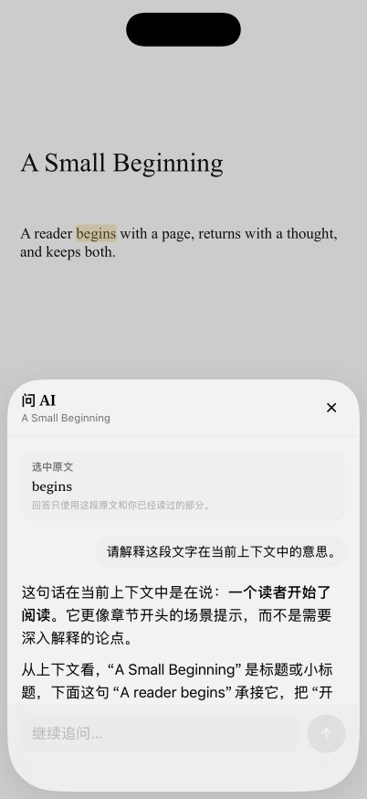
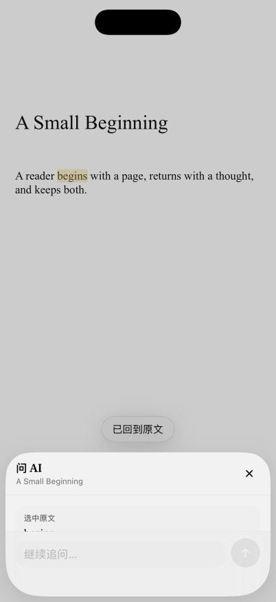

测试结束后已在 App 设置中执行“删除所有 AI 配置和 API Key”，本机 Keychain 不再保留该临时 Key；DeepSeek 控制台上的 Key 仍需持有人撤销。

### 5.3 未能运行验证的部分

- **逐 token 流式**：Provider 返回很快，且当前模型链路按非流式请求实现；只观察到 preparing → completed，未观察到中间 token。
- **手动停止**：按钮在 busy 状态出现，但 Flash 完成太快，未截到“已停止”状态。
- **真实 Provider 下的“去设置”**：本次已配置成功，没有触发该分支；未配置分支在 5.1 已验证显示。
- **重试后成功**：未制造真实失败，重试按钮与失败卡只在未配置场景验证。

这些路径的模型、网络、RAG 与 Agent 逻辑未改；UI 状态机改动集中在 `ReaderHelpSheet`。

## 6. 构建与测试

| 检查 | 结果 |
| --- | --- |
| Debug 模拟器构建 | **BUILD SUCCEEDED** |
| Release 模拟器构建 | **BUILD SUCCEEDED** |
| `DesignSystemTests` | 13 个用例通过（5 个 token + 8 个快照） |
| `ReadiumIntegrationTests` | 13 个用例通过 |
| `swift test` | 411 个用例通过（浮动 chrome 改动只在 App 目标，未重跑） |
| `Package.resolved` | 测试后恢复到 `301d45d0…`，未保留测试副作用 |

命令：

```sh
xcodebuild -project ReadLoop.xcodeproj -scheme ReadLoop \
  -configuration Debug -destination 'id=C380BC09-F7BE-4A18-B856-10E516F9EB3C' \
  -derivedDataPath /tmp/elsepage-dd build

xcodebuild -project ReadLoop.xcodeproj -scheme ReadLoop \
  -destination 'id=C380BC09-F7BE-4A18-B856-10E516F9EB3C' \
  -derivedDataPath /tmp/elsepage-dd \
  -only-testing:DesignSystemTests -only-testing:ReadiumIntegrationTests test

swift test
```

## 7. 未解决问题

1. **逐 token 流式与手动停止未验收**：引用回跳已用 DeepSeek Flash 实测通过；模型链路按非流式实现，未观察到中间 token，Flash 也没有给出足够时间点中停止。
2. **fullScreenCover 入口的 AI 设置链路**：从想法/我的打开的全屏阅读仍未传 `onOpenSettings`；书架 push 入口已可用。
3. **Dynamic Type 与阅读正文**：EPUB 正文字号由阅读设置控制，不跟随系统 Dynamic Type；chrome 被限制在 `xxxLarge`，低视力用户需要依赖阅读字号与 VoiceOver。
4. **AX 下引用提示**：大字号时问答 Sheet 直接使用大高度，引用跳转的“已回到原文”提示可能仍在 Sheet 后方；需要在 AX 下改为 Sheet 内提示。
5. **浮层会覆盖文字**：正文不预留 chrome 边距，顶部/底部胶囊显示时会盖住少量文字，靠页色渐隐收边；这是当前明确选择的取舍，但尚未在真机、长文、横屏和不同字号下做长时间阅读验证。
6. **没有 UI 测试**：浮层边界、渐隐效果和 AX 下胶囊不裁切目前依靠几何常量测试 + 手工截图，未接 XCUITest。
7. **未覆盖**：iPad、横屏、真机、VoiceOver 全流程、中文长文/多章节/图文混排/脚注、DRM 失败样本。

## 8. 后续建议

1. 配置真实 Provider，补跑流式、停止、错误重试、引用回跳与返回问答的端到端验收。
2. 给阅读器加一个最小 UI 测试：打开书后取顶部 chrome 与正文第一行的 frame，断言不相交；再切 AX 字号重跑。
3. 把 `onOpenSettings` 接到 AppShell 的 fullScreenCover Reader，统一两个入口的 AI 修复路径。
4. 用一本 10+ 章的中文书验证目录定位、长文排版和浮层覆盖文字的实际干扰；若覆盖感太强，再决定是否加回最小边距或改成只保留底部浮动面板。
5. 在真机检查材质、ProMotion 下的透明度过渡、键盘弹出时笔记 Sheet 的高度，以及 VoiceOver 对选区工具/高亮菜单的朗读顺序。

## 9. 范围声明

- 未改 RAG、Context Routing、Agent Runtime、防剧透策略。
- 未改 locator 持久化、标注/笔记持久化、会话与反思保存。
- 未批量重构书架、想法、我的、设置等其它模块。
- 未提交、未推送、未合并。

## 10. 最终验收补记（2026-11-16）

最终 UI/UX 验收见 [07-final-uiux-review.md](07-final-uiux-review.md)、[07-regression-report.md](07-regression-report.md)、[07-remaining-issues.md](07-remaining-issues.md)。与阅读器直接相关的修复：

- **P0 持久化**：`flushPosition()` / `flushPreferences()` 会取消正在执行防抖写入的任务自身，导致阅读位置只在后台/退出时落库。已移除自取消；强杀后可恢复到 56%。
- **P1 深色 chrome**：阅读页深色 + 系统浅色时，chrome 仍按系统取色，出现黑字黑胶囊。已让 chrome 与标注浮层跟随阅读主题；浅/深两个方向均已实测。
- 本报告中“暗色”截图为系统深色，未覆盖“阅读主题深色 + 系统浅色”的组合；该组合已纳入最终验收截图。
- 阅读器 Sheet 仍按系统主题渲染，未纳入本次修复；列为剩余问题 N-06。
- 打开阅读器实测 1796ms（解析 24.3ms、Navigator→首帧 1654ms，Debug 模拟器单次采样）；需要真机基线。

最终构建与测试：Debug 通过，`DesignSystemTests` 13、`ReadiumIntegrationTests` 13、`swift test` 411 全部通过，`Package.resolved` 已恢复。未提交。
