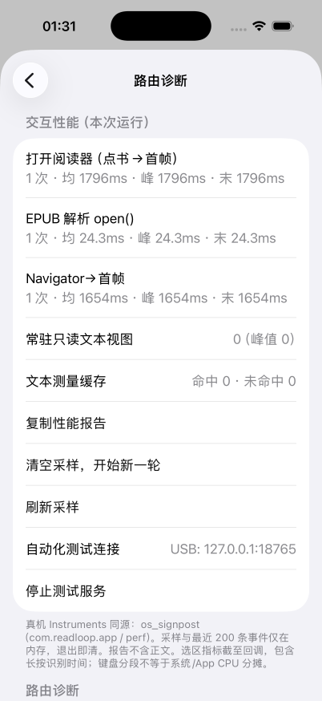

# ElsePage 最终 UI/UX 验收报告

2026-11-16。对象：`ui/ux-modernization` 分支工作区（未提交），iPhone 17 Pro / iOS 26.5 Debug 构建。范围是 UI/UX 最终验收与回归，不包含 RAG、Context Routing、Agent 策略、防剧透逻辑或持久化架构的重构。

证据分级沿用审计口径：**V** 已运行观察；**R** 源码确定但当前样本无法复现；**H** 需要真人用户测试。本文只把 V 写成“当前会发生”。

## 1. 总体判断

阅读器的方向已经成立：正文填满页面、控制栏为两枚浮动胶囊、显示/隐藏不重排；根页面的 16pt 页边距、系统字级和单一语义色也保持统一。最终验收没有发现需要推翻当前设计方向的问题。

但本轮发现并修复了 **1 个 P0 级数据持久化缺陷**、**2 个 P1 级呈现缺陷** 和 **5 个 P2 级细节缺陷**：

| 编号 | 问题 | 级别 | 状态 |
| --- | --- | --- | --- |
| N-01 | 750ms 防抖保存会取消自己，阅读位置与阅读设置只在退到后台/退出时才落库；强制退出会丢最后一页和设置 | **P0** | 已修复并实测 |
| N-02 | 阅读主题与系统配色相反时，浮动 chrome 仍按系统配色取色；系统浅色 + 阅读深色时胶囊里是黑字黑底 | **P1** | 已修复并实测 |
| N-03 | 辅助功能大字号下，当前书行的“补写想法”胶囊压住章节/进度行 | **P1** | 已修复并实测 |
| N-04 | 网格封面占位标题在 120pt 封面上把 “Foundation” 断成 “Foundatio / n” | P2 | 已修复并实测 |
| N-05 | 搜索框只有 36pt、清除按钮命中区约 16pt | P2 | 已修复并实测 |
| N-06 | 阅读器 Sheet 跟随系统主题而不是阅读主题 | P2 | 已修复并实测 |
| N-07 | 阅读器 Sheet 玻璃透出正文 | P2 | 已修复并实测 |
| N-09 | 当前书章节行被补写胶囊的 128pt 预留截断 | P2 | 已修复并实测 |

修复后 Debug 与 Release 构建均通过，`DesignSystemTests` 13 项、`ReadiumIntegrationTests` 13 项、`swift test` 411 项全部通过；`Package.resolved` 已恢复。所有改动仍未提交。

剩余问题集中在**阅读器 Sheet 的主题一致性与材质可读性、反思 Sheet 的主次层级、章节行的截断、横屏行长、AI/引用链路未做真实 Provider 验收**，详见 [07-remaining-issues.md](07-remaining-issues.md)。

## 2. Visual QA

### 2.1 成立的部分

- 三个根页面仍是同一套视觉语言：16pt 页边距、34/22/17/15/13 级文字、单一强调色、无逐行卡片。书架、想法、我的、设置的层级一致（V）。
- 书架首屏层级清楚：大标题 → 搜索 → 当前书 → 全部书籍；当前书是唯一的大封面（V）。
- 阅读器正文铺满安全区，顶部/底部各一枚完整胶囊；胶囊用页面底色填充 + 细描边，正文不会透过胶囊；边缘的页色渐隐能收住被切断的半行（V）。
- 显示/隐藏 chrome 时正文不重排；章节起始页标题完整；暗色阅读页在系统浅色下也不再出现黑字黑底（V，见 N-02 修复）。
- 网格封面占位标题不再断词（V，`shelf-after-fixes.png`）。
- 成就页的背景已与根页面一致，返回按钮也改为同一套玻璃圆形按钮；底部自定义栏仍在（V）。

### 2.2 仍然不成立的部分

| 项目 | 观察 | 证据 | 判断 |
| --- | --- | --- | --- |
| 反思 Sheet 主次 | “这次不写”仍是与“保存”同级的大玻璃胶囊，且比禁用的“保存”更显眼；编辑区大片空白只有占位符 | V，`reflection-ax.png` | UX-019 未收口 |
| 阅读器胶囊边距 | 阅读器胶囊左右 12pt，根页面内容 16pt；同一屏切换时能看出 4pt 差 | V | 轻微对齐不一致 |
| 图标 | 阅读器右上“大小”是本地化后的 SF Symbol，看起来像一个词而不是图标，视觉重量接近书名 | V | 轻微；属于系统符号行为 |
| 高亮色 | 深色阅读页上黄色高亮呈暗橄榄色，和正文对比偏弱 | V，`reader-selection-dark.png` | 轻微；可考虑按主题提亮 |

> N-06 / N-07 / N-09 已在本轮修复：阅读器 Sheet 跟随阅读主题、Sheet 改为阅读页底色不再透字、当前书章节行完整显示。证据见 `reader-annotations-dark-fixed.png`、`reader-appearance-dark-fixed.png`、`reader-sheet-light-in-dark-system.png`、`shelf-chapter-full.png`。

### 2.3 浅色/深色完整性

- 系统浅色：书架、想法、我的、设置、阅读器（浅色主题）全部正常（V）。
- 系统深色：书架与阅读器（系统主题）实测正常，阅读器 chrome 为白字（V，`shelf-dark.png`、`reader-system-dark.png`）；我的/设置本轮未重新截图，沿用既有语义色与上一轮深色审计。
- 阅读主题与系统相反的两个方向都已实测：浅系统 + 深阅读、深系统 + 浅阅读，正文与 chrome 均正确（V，`reader-dark-after-fix.png`、`reader-light-in-dark-system.png`）。Sheet 仍是系统主题，见上表。

## 3. Interaction QA

| 检查 | 结果 | 证据 |
| --- | --- | --- |
| 阅读器全屏所有权 | 阅读器 AX 树无 tab bar；底部目录/标注/进度完整可点 | V |
| 返回/退出 | 顶部只有 X“结束阅读并返回书架”；底部重复的“读到这里”已移除；X 仍承担结束会话/反思语义 | V，UX-009 |
| 左缘返回手势 | 阅读器内从左缘向右滑未观察到弹出阅读器，未发现绕过“结束阅读”的路径；边缘手势建议在真机复验 | V |
| 显示/隐藏 chrome | 轻点正文切换；翻页/滚动会隐藏 chrome；不重排 | V |
| Sheet/Popover | 目录/搜索/标注/设置均为 medium+large detent；Help Sheet 无拖拽条、不能下滑关闭；笔记/反思可下滑 | V |
| 加载状态 | 打开书显示封面 + spinner 的占位；搜索显示“正在搜索…”；AI 显示“正在理解…” | V/R |
| 错误恢复 | AI 未配置时错误卡有“重试”和“去设置聊天模型”，push 入口可打开设置；从设置返回后本次问答线程已丢弃，需要重新选句 | V，UX-007 部分 |
| 取消 | 阅读器 AI 生成中可停止（按钮存在）；反思对话仍无 Stop | R，UX-017 |
| 删除/放弃 | 删书、忘记记忆、关闭有内容的问答都有确认；删高亮有 5 秒“撤销”胶囊 | V/R |
| 误触 | “补写想法”44pt；新搜索清除 44pt；选色/工具 44–48pt | V |
| 动画 | chrome 显隐为 0.18s 透明度过渡；无布局位移 | V |
| 横屏 | 支持横屏；胶囊布局正常，正文重排为一行约 75 个汉字，阅读行长偏长 | V，`reader-landscape.png` |
| 书架手动排序 | 排序菜单选「自定义」后，每本书右上角出现拖动手柄；拖到另一本书上交换两者，其余书不动，重启后保持 | V/R：`manualOrder`（v30 迁移）+ `updateManualOrder`；`LibraryReorderUITests` 覆盖把手，交换由 agent-device 手势验证 |

## 4. Accessibility QA

| 检查 | 结果 | 说明 |
| --- | --- | --- |
| Dynamic Type（根页面） | 通过（本轮修复后） | accessibility-extra-large 下搜索框可增长、当前书标题/作者可换行、“补写想法”改为独立一行，不再压住章节/进度（V，`shelf-ax-after-fixes.png`） |
| Dynamic Type（阅读器） | 通过 | chrome 上限 `xxxLarge`；正文由阅读字号控制；选句工具栏在 AX 下隐藏文字标签但保留 44pt 命中（V） |
| Dynamic Type（Sheet） | 基本通过 | 问答 Sheet 自动使用大高度；阅读设置四主题仍可排下；反思 Sheet 顶部三个动作拥挤但可读（V） |
| VoiceOver | 待复验 | 选区工具/高亮菜单/阅读胶囊有明确 label。AX 树仍暴露重复项：阅读设置每个滑杆出现 3 个同名元素、设置页“默认保存录音”旁有一个无名 switch “1”、部分 Sheet 的导航栏 label 变成第一个按钮（“恢复默认”“这次不写”）。未做 VoiceOver 全流程，暂记为待验证而非已确认缺陷 |
| Reduce Motion | 基本通过 | 阅读器就绪、关键动效有 nil 分支；chrome 仍保留 0.18s 透明度过渡（可接受） |
| Reduce Transparency | 部分 | 头部玻璃胶囊与 Tab 栏有实色兜底；阅读器内的选区/高亮菜单仍用 `.ultraThinMaterial`，未处理 |
| 对比度 | 通过（修复后） | 深色页 + 浅色系统不再出现黑字黑底；深色页上的黄色高亮对比偏弱，见 §2.2 |
| 触控目标 | 通过（本轮修复后） | 阅读器 44pt；选区工具 48pt；搜索清除与搜索框 44pt；Tab 为系统控件 |
| 设备尺寸 | 仅 iPhone 17 Pro | iPhone SE/小屏未验证；工程 `TARGETED_DEVICE_FAMILY=1`，不支持 iPad |
| 横竖屏 | 通过，有排版遗留 | 横屏可用；正文行长过宽，缺少最大行宽约束 |

## 5. Performance QA

### 5.1 已测到的数字

来自 App 自身的 `Perf` 诊断屏（Debug、模拟器、本书 1 次采样）：

| 指标 | 数值 |
| --- | --- |
| 打开阅读器（点书 → 首帧） | **1796 ms** |
| EPUB 解析 `open()` | 24.3 ms |
| Navigator → 首帧 | **1654 ms** |
| 常驻只读文本视图 | 0（峰值 0） |
| 文本测量缓存 | 命中 0 / 未命中 0 |
| 进程常驻内存（打开书后） | 387,984 kB（约 379 MB，模拟器 Debug） |

结论：打开书的主要成本不在 EPUB 解析，而在 Readium navigator 构造到首帧的 1.65s。占位页给出了可见反馈，但 1.8s 仍是可感知的等待；需要真机基线后再判断是否必须优化。

### 5.2 未能测到的部分

- **帧健康**：`perf frames` 明确返回 “Apple frame-health sampling is currently available only on connected iOS devices”，模拟器不可用。没有滚动/翻页丢帧数字。
- **Time Profiler**：`agent-device perf cpu profile` 的 stop 被强制终止，trace 不可读；改用 `xctrace record --attach` 时无法定位模拟器进程（`Cannot find process matching name: ReadLoop` / `provided pid`）。因此没有 CPU 火焰图。
- **内存趋势**：只有单次常驻内存快照，没有前后台切换、反复开书、长时间阅读的曲线，不能据此判断泄漏。

### 5.3 XCTest 基线（2026-11-16 新增）

`Tests/ReadLoopUITests` 把两个数字变成了可重跑的基线（iPhone 17 Pro 模拟器、Debug、各 3 次）：

| 指标 | 两次构建的均值范围 | 说明 |
| --- | --- | --- |
| 冷启动（`XCTApplicationLaunchMetric`） | **1.508–1.617 s** | 首轮 1.546 / 1.478 / 1.500；全新 DerivedData 1.677 / 1.606 / 1.568 |
| 点书 → 阅读器 chrome 可点（`XCTClockMetric`） | **2.188–2.242 s** | 首轮 2.247 / 2.237 / 2.241；全新构建 2.188 / 2.178 / 2.199，含 XCUITest 轮询开销 |

新增的 `readerOpen` os_signpost 区间已可从 Instruments 直接看到；但 `XCTOSSignpostMetric` 在本工程的自定义区间上没有产出样本（只有 App 内 `Perf` 屏能读到），所以 CI 里用墙钟指标，不用 signpost 指标。内存指标在 UI 测试中量到的是测试进程侧的数值，不能与 `Perf` 屏的 387,984 kB 直接比较，因此不作为基线。

### 5.3 静态风险（不当作指标）

- 标注列表每一行都会在 `chapters` 中线性查找对应章节（`annotationSortKey`），标注很多时是 O(n·m)；当前样本只有 1–2 条，未观察到卡顿。
- 阅读器打开时 EPUB 解析在后台 preload，navigator 在主线程构造；1.65s 的首帧成本需要真机 Instruments 验证具体栈。
- 未发现主线程同步数据库调用；位置/偏好写入都是 async + 防抖（本轮修复了防抖取消自身的问题）。

## 6. 设计一致性评价

**根页面：A−。** 书架/想法/我的/设置已经像同一个产品：同一页边距、同一标题行、同一玻璃胶囊、同一语义色。当前书行的 AX 退化问题本轮修掉后，根页面没有阻断性视觉缺陷。

**阅读器：B+。** 正文与浮动胶囊的方向成立，浅色/深色/横屏都能工作。扣分项是 Sheet 仍按系统主题渲染、玻璃材质透出正文、反思 Sheet 的主次动作、章节行截断，以及“大小”这类本地化符号的视觉重量。

**深层页面：B−。** 成就页已明显收敛；想法/我的详情页当前无数据，无法实拍，但源码未再发现审计所述的 19pt/20pt 旧容器，工具栏也已收敛。反思 Sheet 仍是旧视觉语言。它们不影响主流程，但会让“从根页面进入像换了一个 App”的印象残留。

## 7. 当前最严重的剩余问题

1. **AI 链路只剩真实 Provider 未验收。** App 侧已用 `-fake-provider` 做确定性覆盖：流式、停止、失败重试、`[E1]` 引用校验与跳回原文、防剧透前置文案都已在 XCUITest 中断言。仍未验证的是真实 SSE 的逐 token 时序、鉴权/超时错误分类，以及可用/不可用索引下的 `failClosedReason` 分支。
2. **反思 Sheet 的主次与可恢复性。** “这次不写”仍比“保存”显眼；草稿不跨启动；待补写仍只对当前书可见（UX-002/019/022）。
3. **横屏行长过宽。** 一行约 75 个汉字，超出舒适阅读行长；需要最大行宽或双栏策略（产品决策）。
4. **图标 Tab 无文字标签（UX-025）。** 首次使用仍需学习“灯泡=想法、人像=我的”。
5. **性能只有模拟器基线。** 点书 → chrome 2.19s；还缺真机 Release 的 Time Profiler，目前不能判断是模拟器成本还是实现问题。
6. **VoiceOver 的重复元素/导航栏标签需要真人复验。** 目前只能确认 AX 树里存在重复，不确认 VoiceOver 的实际朗读顺序。

已从本清单移除（本轮修复）：阅读器 Sheet 主题与透字（N-06/N-07）、当前书章节行截断（N-09）。

## 8. 最值得继续优化的交互

1. **反思捕获**：把“这次不写”降为次要文字按钮；保存为主 CTA；草稿可恢复；待补写做成跨书收件箱。它直接决定“读 → 反思”的闭环是否成立。
2. **打开阅读器的 1.8s**：先测真机；若仍 >1s，优先查 navigator 首帧而不是 EPUB 解析（解析仅 24ms）。
3. **选区/高亮菜单的材质**：在深色页上把 `.ultraThinMaterial` 换成更实的页面色或提高不透明度，保证标签不被正文穿透。
4. **当前书行的信息取舍**：让章节行完整显示，把补写胶囊移到行下方或标题行，不再用 128pt 预留换截断。
5. **多书找回**：排序已有，但网格仍缺“读到哪/最近读过”的轻量元信息（UX-006）。

## 9. 仍需要真人用户测试的假设

| 假设 | 为什么需要真人 |
| --- | --- |
| 浮动 chrome 覆盖少量正文是可接受的 | 本轮只在模拟器看了几页；长文、不同字号、横屏下的干扰感需要真实阅读 30 分钟以上 |
| 图标 Tab 可以被识别 | 灯泡/人像/加号的含义没有文字；需要 5–8 人命名测试 |
| “想法”与“看法”不是同义词 | 术语未改；需要用户判断是否混淆 |
| “这次不写”的语义符合预期 | 文案已改，但仍永久关闭本次补写；需要观察用户是否理解为“这次” |
| 横屏行长不影响阅读 | 75 字/行远超常见舒适区间；需要真实横屏阅读测试 |
| VoiceOver 顺序可用 | AX 树有重复元素；需要真人 VoiceOver 走查 |
| 1.8s 打开等待可接受 | 模拟器 Debug 数字不能代表真机；需要真机 + Release 基线 |

## 10. 发布前必须完成

1. **真实 Provider 端到端验收**：连接、解释、追问、停止、失败重试、引用回跳、过去反思只读、防剧透边界；App 侧链路已有假客户端用例，这一步只补真实网络的时序与错误分类。结束后撤销测试 Key，并确认本机无残留。
2. **真机持久化验证**：翻页后直接强杀、修改字号/主题后直接强杀、后台/前台、旋转；确认 N-01 的修复在 Release 真机上成立。
3. **VoiceOver + Reduce Motion + Reduce Transparency 走查**：至少覆盖书架、阅读器 chrome、选区工具、高亮菜单、问答 Sheet、反思 Sheet。
4. **小屏与横屏**：iPhone SE 尺寸、横屏阅读行长、键盘弹出时的笔记/反思 Sheet。
5. **多书场景验收（5 本以上）**：网格滚动与三列换行、长按菜单命中区、删除后布局重排、当前书切换；当前只有 2 本测试书，拖拽排序（N-17）也还没有实现。
6. **把“反思 Sheet 主次”做成明确决策**，不要以现状发布（阅读器 Sheet 主题已定为“跟书”）。
7. **清理模拟器测试数据**：《缓慢的注视》、ReadLoop Foundation Fixture、测试高亮与待补写会话不应出现在演示/截图里。

## 11. 证据索引

截图在 [`assets/final-review/`](assets/final-review/)：

- `shelf-after-fixes.png`：修复后的书架与封面占位标题
- `shelf-ax-after-fixes.png`：accessibility-extra-large 下的当前书行
- `reader-dark-before-fix.png` / `reader-dark-after-fix.png`：深色阅读 + 浅色系统的 chrome 修复前后
- `reader-light-in-dark-system.png`：反向组合
- `reader-restore-56.png`：强杀后恢复到 56%
- `reader-selection-dark.png`：深色页选区工具
- `reader-annotations-dark.png`：深色页 + 浅色标注 Sheet（修复前）
- `reader-annotations-dark-fixed.png`：深色页 + 深色标注 Sheet（修复后）
- `reader-appearance-sheet.png`：阅读设置 Sheet 的透字（修复前）
- `reader-appearance-dark-fixed.png`：深色阅读下的阅读设置 Sheet（修复后）
- `reader-sheet-light-in-dark-system.png`：深色系统 + 浅色阅读时的 Sheet（修复后）
- `reader-sheet-system-dark.png`：浅色阅读 + 深色系统 Sheet（修复前）
- `shelf-chapter-full.png`：章节行完整显示、补写胶囊独立一行（修复后）
- `reader-landscape.png`：横屏 chrome 与行长
- `reader-chrome-light.png`：浅色阅读 chrome
- `shelf-dark.png` / `reader-system-dark.png`：系统深色
- `help-start-ax.png` / `help-error-ax.png`：问答空态与未配置错误卡
- `reflection-ax.png`：反思 Sheet 的主次动作
- `achievements.png`：成就页
- `perf-diagnostics.png`：App 内交互性能采样

## 12. 工具链升级（2026-11-16）

本轮把验收从“人工点一遍”升级为可重跑的门禁，全部开源/原生，没有改产品方向：

| 能力 | 落点 | 状态 |
| --- | --- | --- |
| XCUITest 无障碍审计 | `Tests/ReadLoopUITests` | 结构审计（`hitRegion`、`sufficientElementDescription`）已对书架/想法/我的/设置/阅读器 5 屏生效并通过；视觉审计（`contrast`、`textClipped`、`dynamicType`）目前只报告，不阻断 |
| AI 链路确定性用例 | `Tests/ReadLoopUITests/AIHelpUITests.swift` | `-fake-provider [slow\|failure]` 注入假客户端，覆盖流式/停止、失败/重试、引用校验与跳回原文，不写 Key、不出网 |
| 性能基线 | 同上 | 冷启动 1.508 s、点书→chrome 2.242 s（各 3 次，见 §5.3） |
| 感知快照 | `pointfreeco/swift-snapshot-testing` 1.19.7 | 替换手写 PNG 字节比对；8 张 Light/Dark 基准，`SNAPSHOT_RECORD=1` 重录 |
| 格式与 Lint | `.swift-format`、`.swiftlint.yml`、`Scripts/lint.sh` | 默认报告模式；CI 用 `LINT_STRICT=1` 阻断 |
| 网络调试 | `kean/Pulse` 5.2.3 | 仅 DEBUG 且带 `-pulse` 启动时启用；设置 → 诊断 → 网络请求 |

审计第一次运行就给出了三条新证据：

1. **封面占位标题**（`ReadLoop Foundation Fixture`、`ReadLoop Contributors`）被判对比度不足且在大字号下可能裁切。封面是装饰性的，卡片下方已有完整书名，但 AX 仍把封面文字当正文暴露——这与 N-12 的重复元素是同一类问题。
2. **根页面与设置的次级文字**大量落在“接近通过”区间（`textSecondary` / `textTertiary`），是真实的对比度债务，不是误报。
3. **设置页的分组标题与页脚**被判“Dynamic Type 不支持”，属于 SwiftUI 审计的已知误报；同类误报也是视觉审计暂不阻断的原因。

因此视觉审计只作为发布前的报告项；要把它变成硬门禁，先做 [剩余问题](07-remaining-issues.md) 中 N-15 的调色板收敛。

## 13. 范围声明

- 未改 RAG、Context Routing、Agent Runtime、防剧透策略。
- 未改 locator/标注/笔记/会话的持久化模型；只修复了防抖保存取消自身的实现缺陷。
- 未批量重构书架、想法、我的、设置等其它模块。
- 未提交、未推送、未合并。
